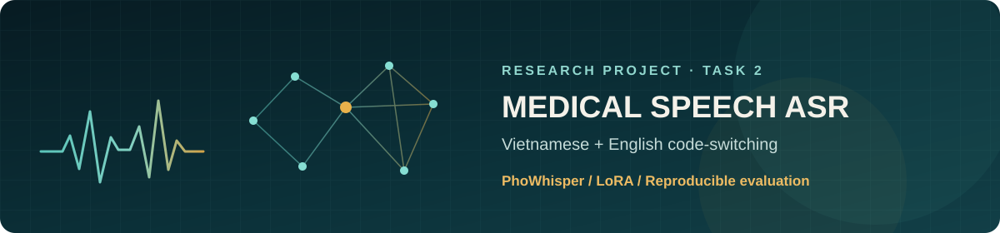
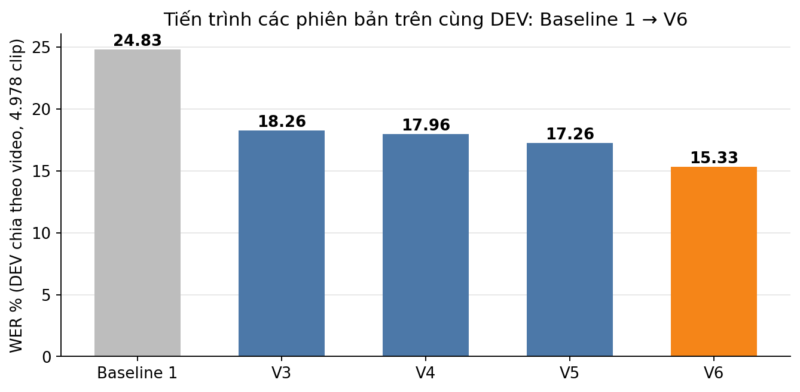

<p align="center"></p>

<h1 align="center">Nhận dạng tiếng nói y khoa Việt–Anh</h1>

<p align="center">PhoWhisper · Whisper · LoRA · ViMedCSS · Thực nghiệm Task 2</p>

<p align="center">
  <a href="#kết-quả-chính">Kết quả</a> ·
  <a href="#xem-kết-quả-không-cần-gpu">Notebook</a> ·
  <a href="#tái-lập-thí-nghiệm">Tái lập</a> ·
  <a href="reports/task2_20261030/TASK2_REPORT_VI.md">Báo cáo đầy đủ</a>
</p>

> **Bài toán.** Chuyển tiếng nói y khoa tiếng Việt có xen thuật ngữ tiếng Anh thành bản ghi văn bản. Dự án so sánh hai baseline zero-shot, tinh chỉnh bằng LoRA và kiểm tra tác động của cách chia dữ liệu, SpecAugment, giải mã và kích thước mô hình.

## Kết quả chính

**DEV chính thức — 4 nguồn, 5.168 clip.** WER càng thấp càng tốt. Các dòng dưới đây được chấm trên cùng tập DEV và cùng bộ chuẩn hóa của nhóm.

| Hệ thống | Thiết lập | WER ↓ | Recall thuật ngữ* ↑ |
|:--|:--|--:|--:|
| Baseline 1 | PhoWhisper-small, zero-shot | 24,73% | 12,96% |
| Baseline 2 | Whisper-small, zero-shot | 58,75% | 16,05% |
| V1 | PhoWhisper-small + LoRA | 18,48% | 71,26% |
| V2 | Huấn luyện tiếp V1, learning rate thấp hơn | 19,08% | — |
| **V-Final** | **Whisper-large-v3 + LoRA, SpecAugment, oversampling, beam 5** | **15,07%** | **81,30%** |

Trên **ViMedCSS TEST/HARD chính thức**, V-Final đạt **11,40% / 16,42% WER** theo cách chấm của nhóm. [Kết quả gốc](experiments/O3W_whisper_large_v3_lora_official_termos/eval/) nằm trong repo; [báo cáo](reports/task2_20261030/TASK2_REPORT_VI.md) giải thích split, scorer và giới hạn khi đối chiếu với paper.

<sub>* Recall thuật ngữ dùng phép khớp chuỗi con trên nhãn `cs_terms`; không tương đương CS-WER hay đánh giá thủ công thuật ngữ.</sub>

### Tiến trình trên DEV chia theo video

Các bản V3–V6 dùng **một tập DEV khác** gồm 4.978 clip và ViMedCSS được chia lại theo video. Không lấy WER trong hình này trừ WER ở bảng DEV chính thức.

<p align="center"></p>

V3 sửa cách chia ViMedCSS; V4 thêm SpecAugment; V5 dùng beam 5; V6 đổi sang PhoWhisper-medium. **Đây là tiến trình thử nghiệm**, không phải ablation một biến cho mọi bước: V6 thay cả backbone, learning rate và số epoch. [Bảng số và phân tích](reports/task2_20261030/TASK2_REPORT_VI.md).

## Xem kết quả không cần GPU

[ARS/](ARS/) chứa **7 notebook có sẵn output**: dữ liệu, baseline, V1, V2, V-Final, thử nghiệm thành phần và tính khả thi. Có thể mở để đọc bảng, hình và log mà không tải mô hình hoặc huấn luyện lại. Xem [hướng dẫn ARS](ARS/README.md).

| Tài liệu | Nội dung |
|:--|:--|
| [Báo cáo tiếng Việt](reports/task2_20261030/TASK2_REPORT_VI.md) | Phương pháp, kết quả, phân tích lỗi và giới hạn |
| [Bảng và biểu đồ](reports/task2_20261030/) | Số liệu và hình dùng trong báo cáo |
| [Slide Task 2](reports/task2_20261030/web_slides/) | Bản HTML và PowerPoint |
| [Kết quả local](results/local_runs/) | `metrics.json`, `predictions.jsonl`, lịch sử huấn luyện |
| [Kết quả Colab](experiments/) | Cấu hình, nhật ký và kết quả đánh giá |

## Tái lập thí nghiệm

**Yêu cầu:** Python, PyTorch/CUDA phù hợp GPU, và bốn corpus VIVOS, FLEURS `vi_vn`, VietMed, ViMedCSS đã tải riêng. Repo **không chứa** audio, Parquet, trọng số mô hình hay adapter LoRA. Các thư viện Python nằm trong [requirements.txt](requirements.txt); môi trường và GPU của từng lần chạy được ghi trong `runs.jsonl`/manifest.

Từ thư mục `ASR/`:

```bash
pip install -r requirements.txt
python scripts/prepare_data.py --raw-dir ../dataset/ASR
python scripts/evaluate.py B0_phowhisper_small_zeroshot --split dev
python scripts/train.py V1_phowhisper_small_lora
python scripts/evaluate.py V1_phowhisper_small_lora --split dev
```

`prepare_data.py` đưa audio về **16 kHz mono FLAC** trong Parquet và tạo `data/registry.json`. Cấu hình mỗi thí nghiệm kế thừa [mặc định chung](experiments/_base.yaml); không sửa config của một lần chạy đã có kết quả. Trên GPU 6 GB, xem [manifest V1 local](results/local_runs/V1_phowhisper_small_lora/local_v1/manifest.json): batch 1, tích lũy gradient 32, `fp16`, seed 13. [Cấu hình V1](experiments/V1_phowhisper_small_lora/config.yaml) trong repo đặt batch 16 cho GPU nhiều bộ nhớ hơn.

> TEST/HARD được giữ để đánh giá sau khi chọn mô hình trên DEV. `evaluate.py --split test|hard` yêu cầu `--allow-test`; xem [quy trình và bản chốt](reports/task2_20261030/TASK2_REPORT_VI.md) trước khi chạy.

## Cấu trúc repo

| Đường dẫn | Vai trò |
|:--|:--|
| [`asr/`](asr/) | Đọc dữ liệu, dựng mô hình/LoRA, chấm WER/CER và thuật ngữ |
| [`scripts/`](scripts/) | Chuẩn bị dữ liệu, train, evaluate và dựng báo cáo |
| [`experiments/`](experiments/) | Cấu hình theo ID, kết quả, dự đoán, nhật ký |
| [`results/local_runs/`](results/local_runs/) | Bản xuất kết quả từ các lần chạy trên laptop |
| [`ARS/`](ARS/) | Notebook trình bày với output đã lưu |
| [`reports/task2_20261030/`](reports/task2_20261030/) | Báo cáo, bảng, hình và slide |
| [`notebooks/local/`](notebooks/local/) | Notebook huấn luyện và đánh giá gốc |

## Cách đọc kết quả và giới hạn

- **Hai DEV khác nhau:** DEV chính thức có 5.168 clip; DEV chia theo video có 4.978 clip. Chỉ so WER khi cùng tập và cùng cách chấm.
- **Rò rỉ video trong split gốc:** 92,7% clip ViMedCSS DEV thuộc video cũng có trong Train. Nhóm chia lại theo video cho V3–V6; V-Final dùng Train chính thức để đánh giá trên TEST/HARD chính thức. Đọc [phân tích split](reports/task2_20261030/TASK2_REPORT_VI.md) trước khi suy diễn khả năng tổng quát.
- **So với paper:** dữ liệu huấn luyện, chuẩn hóa văn bản và cách tính CS-WER khác nhau. Số WER đặt cạnh paper là đối chiếu có điều kiện, không chứng minh phương pháp của nhóm tốt hơn paper.
- **Ứng dụng:** phù hợp để tạo bản nháp có người rà soát. Thuật ngữ hiếm, lỗi biên clip và tốc độ cả chuỗi ASR→MT vẫn cần kiểm tra trước khi dùng như sản phẩm độc lập.

**Nhóm 2 · DPL302m, FPT University:** Nguyen Luong Hai Dang, Tran Trung Tin, Vo Hieu Thang. GVHD: Nguyen Xuan Huy.
