# Báo cáo Task 2: ASR tiếng Việt y khoa code-switching

Xử lý dữ liệu, thực nghiệm Baseline và phát triển phương pháp đề xuất (Whisper + LoRA).

Mã nhóm: ............ · Sinh viên: Nguyen Luong Hai Dang, Tran Trung Tin, Vo Hieu Thang · GVHD: Nguyen Xuan Huy

Ngày chốt số liệu: 01/11/2026. Bảng ở `tables/`, hình ở `figures/`, cùng thư mục với báo cáo này.

## Tóm tắt

- **Dữ liệu:** 4 corpus công khai (VIVOS, FLEURS, VietMed, ViMedCSS), 40.914 clip, tỷ lệ Train/Dev/Test 71,1 / 12,6 / 16,3% theo clip. Kiểm tra split chính thức của ViMedCSS cho thấy 92,7% clip DEV thuộc video có trong Train, nên nhóm chia lại theo video cho các bản V3 trở đi.
- **Baseline:** PhoWhisper-small và Whisper-small, chạy zero-shot. Pipeline tái lập gần đúng số công bố của PhoWhisper-small trên VIVOS (6,28% so với 6,33%).
- **Phương pháp đề xuất:** LoRA qua các bản V1 → V7. Trên ViMedCSS TEST chia theo video, WER giảm từ 30,02% (zero-shot) xuống 14,78% (V6). Trên TEST và HARD chính thức, V7 đạt 11,40% và 16,42%, so với 23,14% và 27,14% của PhoWhisper-large zero-shot do nhóm chạy lại. Thuật ngữ hiếm vẫn là điểm yếu: recall trên HARD chỉ 45,8–50,3%.
- **So với paper:** WER của V7 thấp hơn số công bố trên ViMedCSS và VietMed, chưa đạt PhoWhisper-large trên VIVOS. Đây là so sánh số, không phải kết luận phương pháp tốt hơn, vì khác dữ liệu train, backbone và cách chấm (mục 3.4).
- **Rò rỉ video:** một cặp thử nghiệm sơ bộ chưa cho thấy tác dụng đo được trên WER (DiD +0,30, khoảng tin cậy chứa 0), trong khi recall thuật ngữ tăng rõ ở nhóm video bị rò rỉ. Đây chưa phải kết luận vì thử nghiệm dừng ở 1/3 seed dự kiến (mục 3.5).
- **Tính khả thi:** khả thi có điều kiện cho Task 3 (mục 3.6).

## Quy ước đọc số liệu

 WER tính sau chuẩn hóa (NFC, chữ thường, bỏ dấu câu). Có **hai tập DEV khác nhau**, không so chéo:
- **DEV chính thức** (5.168 clip): split gốc của từng corpus. Dùng cho Baseline 1, Baseline 2, V1, V2.
- **DEV chia theo video** (4.978 clip): ViMedCSS chia lại theo video, 0 video trùng Train. Dùng cho Baseline 1 khi chấm lại, V3 → V6.
Cầu nối giữa hai tập là Baseline 1 chấm trên cả hai DEV (24,73% so với 24,83%): cùng mô hình, hai tập DEV cho kết quả gần như nhau.

V7 (mục 3.4) và các mô hình zero-shot PhoWhisper-small, PhoWhisper-large, Whisper-large-v3 chạy trên Colab A100 được chấm trên **TEST chính thức (6.668 clip, ViMedCSS 1.614) và HARD chính thức (658 clip)**, đúng các tập paper dùng. Kết quả nằm ở `ASR/experiments/<ID>/eval/`, không ở `local/runs/`.

---

## Tên các phiên bản

Thư mục kết quả giữ mã thí nghiệm gốc nên đường dẫn trong báo cáo có thể khác tên phiên bản.

| Phiên bản | Nội dung | Thư mục thí nghiệm |
|---|---|---|
| Baseline 1 | PhoWhisper-small zero-shot | `B0_phowhisper_small_zeroshot` |
| Baseline 2 | Whisper-small zero-shot | `B1_whisper_small_zeroshot` |
| V1 LoRA cơ bản | PhoWhisper-small + LoRA, 4 nguồn | `V1_phowhisper_small_lora` |
| V2 Train tiếp | Train tiếp V1, lr thấp hơn | `V2_phowhisper_small_lora_cont` |
| V3 Chia theo video | ViMedCSS chia lại theo video | `V3_phowhisper_small_lora_vsplit` |
| V4 SpecAugment | Thêm tăng cường dữ liệu | `V4_phowhisper_small_lora_vsplit_specaug` |
| V5 SpecAugment + Beam | V4 giải mã beam 5 | `V4B_phowhisper_small_lora_vsplit_specaug_beam5` |
| V6 Medium + Beam | PhoWhisper-medium, beam 5 | `V5B_phowhisper_medium_lora_vsplit_specaug_beam5` |
| V7 Large + Thuật ngữ hiếm | Whisper-large-v3, oversampling, Train chính thức | `O3W_whisper_large_v3_lora_official_termos` |

## Giai đoạn 1 — Dữ liệu

### 1.1 Thống kê nguồn dữ liệu

Cả 4 nguồn là **Online** (corpus công khai có sẵn transcript). Nhóm **không thu thập Offline** (không tự thu âm/khảo sát).

| Nguồn | Loại | Cách thu thập | Clip (train/dev/test[/hard]) | Giờ audio | Định dạng sau xử lý | Dung lượng | Trường dữ liệu |
|---|---|---|---|---:|---|---:|---|
| VIVOS | Online | Corpus công khai AILAB (đọc văn bản, nhiều người nói) | 11.476 / 184 / 760 | 15,7 | FLAC 16 kHz mono trong parquet | 915 MB | id, group=speaker, text |
| FLEURS vi_vn | Online | Corpus công khai Google (câu đọc) | 2.994 / 361 / 857 | 13,3 | như trên | 627 MB | id, group=sentence id, text |
| VietMed | Online | Corpus công khai thoại y khoa thực tế | 2.773 / 2.912 / 3.437 | 15,8 | như trên | 699 MB | id, group=bản ghi, speaker, text |
| ViMedCSS | Online | Corpus code-switching y khoa Việt–Anh (arXiv 2602.12911), clip cắt từ video nguồn | 11.832 / 1.714 / 1.614 / 658 hard | 30,8 | như trên | 1,9 GB | id, group=video, text, **cs_terms** |

Schema thống nhất (`scripts/prepare_data.py`): `id, source, split, group_id, speaker_id, text, cs_terms, duration, audio`. Audio được resample 16 kHz, gộp mono, nén FLAC. Số liệu chi tiết từng split: `tables/data_stats_by_source_split.csv`, `data/registry.json` (kèm sha256).

*Đối chiếu với paper ViMedCSS:* paper ghi 16.576 clip / 34,57 giờ cho toàn corpus nhưng các split cộng lại chỉ 15.820 clip / 32,63 giờ (paper không giải thích chênh lệch). Số của nhóm là 15.818 clip / 30,8 giờ (đo từ audio sau khi resample 16 kHz), lệch 1–2 clip so với paper ở Train và Test; chênh lệch số giờ chưa được làm rõ.

### 1.2 Làm sạch và gán nhãn

Quy trình (đều có trong mã nguồn, chạy lặp lại được với seed 13):

| Bước | Việc làm | Kết quả định lượng |
|---|---|---|
| 1. Chuẩn hóa audio | resample 16 kHz, mono, FLAC; bỏ clip ngoài (0, 30 s] | `asr/data.py::load_split` |
| 2. Chuẩn hóa văn bản | NFC, chữ thường, dấu câu → khoảng trắng (cùng một luật cho nhãn huấn luyện và chấm điểm) | `asr/metrics.py::normalize_text` |
| 3. Loại trùng | clip trùng nội dung trong ViMedCSS | **4 clip** bị loại |
| 4. Loại nhiễu | clip im lặng (đỉnh biên độ < 1e-3) | **64 clip** bị loại |
| 5. Loại nhãn bất thường | nhãn dày hơn 16 token/giây (nhãn lệch audio) khỏi Train | **14 clip** (`v3_train_exclude.json`: 13 ViMedCSS, 1 VIVOS) |
| 6. Giá trị thiếu | `speaker_id` rỗng ở FLEURS/ViMedCSS (corpus không cung cấp); không suy diễn | ghi nhận; chỉ dùng `group_id` để chống rò rỉ |
| 7. Chống rò rỉ | chia lại ViMedCSS theo video (mục 1.4) | 0 video trùng |
| 8. Khóa TEST | `evaluate.py --split test` bắt buộc `--allow-test`; chọn mô hình chỉ trên DEV | `README.md` |

**Gán nhãn:** nhóm không gán nhãn thủ công; transcript lấy từ chính corpus. Vì vậy **không có Inter-annotator agreement (Cohen/Fleiss Kappa)**. Hệ quả cần nói rõ: chất lượng nhãn không được đo, và có dấu hiệu nhãn lệch audio ở VietMed/ViMedCSS (xem 3.2). Nhãn thuật ngữ (`cs_terms`) do tác giả ViMedCSS cung cấp.

### 1.3 Thống kê mô tả và mất cân bằng

**Tỷ lệ Train/Dev/Test** (4 nguồn, split chính thức, 40.914 clip, `tables/split_ratio_official.csv`):

| Split | Clip | % clip | Giờ | % giờ | Số từ | % từ |
|---|---:|---:|---:|---:|---:|---:|
| Train | 29.075 | **71,1%** | 51,4 | 69,3% | 617.949 | 68,7% |
| Dev | 5.171 | **12,6%** | 9,9 | 13,3% | 128.087 | 14,2% |
| Test | 6.668 | **16,3%** | 13,0 | 17,5% | 153.292 | 17,0% |

Gần 70/15/15 (lệch +1,1 / −2,4 / +1,3 điểm %). Không chia lại toàn bộ để giữ split chính thức; bản V3 (ViMedCSS chia theo video, 41.504 clip) có Train 72,1% / Dev 12,0% / Test 15,9% theo clip (`tables/split_ratio_v3.csv`). 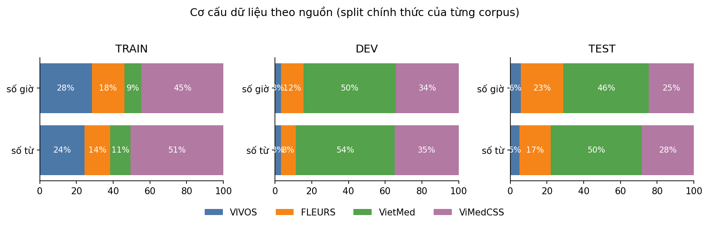

*Hình 1. Cơ cấu nguồn dữ liệu*

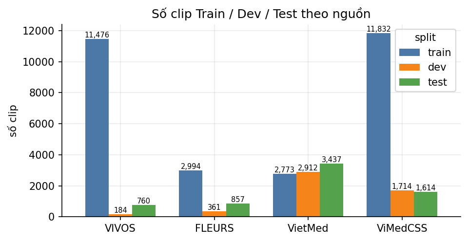

*Hình 2. Phân bố split theo từng nguồn*

**ASR không có "lớp" như bài toán phân loại**, nên mất cân bằng được đo trên bốn trục, mỗi trục có số liệu cụ thể:

1. **Theo nguồn (miền): Train và Dev lệch nhau.** VietMed chỉ chiếm **10,6% số từ Train** (9% số giờ) nhưng chiếm **55,6% số từ DEV**; ViMedCSS chiếm 52,6% Train và 32,7% DEV; VIVOS chiếm 23,4% Train nhưng chỉ 3,3% DEV (`fig4_source_imbalance.png`). Hệ quả: điểm tổng trên DEV chủ yếu phản ánh VietMed.
2. **Theo thuật ngữ y khoa (đuôi dài).** ViMedCSS Train bản chia theo video có 13.295 lượt thuật ngữ, **831 thuật ngữ khác nhau** (Train chính thức có 12.294 lượt, 610 thuật ngữ). Thuật ngữ phổ biến nhất (*virus*, 793 lần) chiếm 6,0%; top-10 chiếm **22,5%**; top-50 chiếm 45,8%. Có **173 thuật ngữ chỉ xuất hiện 1 lần** và **390 thuật ngữ dưới 5 lần** (47% số thuật ngữ) (`fig3_term_long_tail.png`).
3. **Thuật ngữ đã thấy / chưa thấy.** Trên DEV chia theo video, 94,0% lượt thuật ngữ đã có trong Train, nhưng có 31/258 thuật ngữ **chưa từng thấy** (96 lượt). Recall của V6: đã thấy **75,8%**, chưa thấy **20,8%**.
4. **Theo video (rò rỉ).** Trong split chính thức của ViMedCSS, **92,7% clip DEV** (1.589/1.714) và 81,7% clip TRAIN thuộc video xuất hiện ở cả Train lẫn Dev/Test/Hard; 909/1.022 video DEV trùng Train, 898 video TEST trùng Train. Đây là mất cân bằng nguy hiểm nhất vì làm số liệu lạc quan. (Paper ViMedCSS không nêu có tách theo video hay không; con số trên là kết quả kiểm tra `group_id` = video nguồn của nhóm.)

Thêm một lưu ý về nguồn: PhoWhisper đã được tinh chỉnh trên VIVOS (prior exposure), nên Baseline 1 đạt 0,42% WER trên VIVOS DEV — không phản ánh khả năng tổng quát.

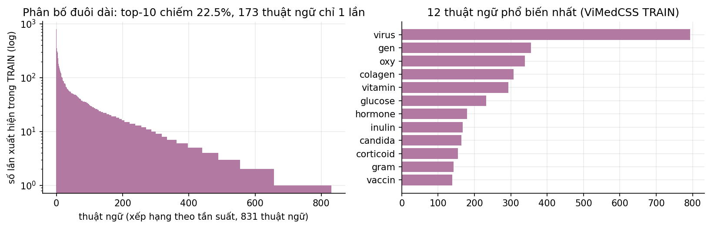

*Hình 3. Đuôi dài của thuật ngữ y khoa trong Train*

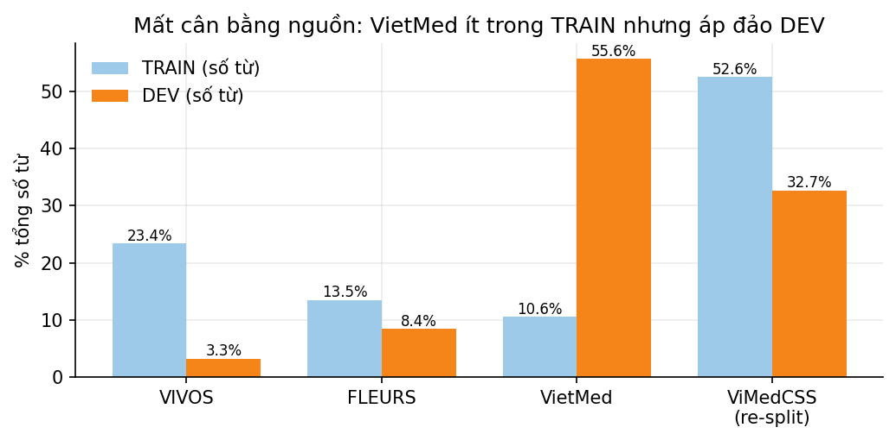

*Hình 4. Tỷ trọng nguồn ở Train và DEV*

### 1.4 Xử lý mất cân bằng và so sánh trước/sau

| Vấn đề | Giải pháp áp dụng | Trước | Sau |
|---|---|---|---|
| Rò rỉ video Train→Dev/Test | **Chia lại ViMedCSS theo video** 80/10/10 (seed 13), gộp split cũ trước khi chia | 92,7% clip DEV trùng video Train; 909 video DEV trùng | **0** video trùng, 0% clip DEV |
| Split Hard | Hard chia lại theo video cùng các split khác | 658 clip | 71 clip (nhỏ: yếu về thống kê, không so trực tiếp với Hard 658 của paper) |
| Clip trùng/im lặng/nhãn lệch | Loại trước khi chia | — | −4 trùng, −64 im lặng, −14 nhãn bất thường |
| Quá khớp theo nguồn và thuật ngữ hiếm | **Data augmentation**: SpecAugment (V4) mask 5% thời gian + 5% tần số | — | DEV 18,26% → 17,96% (−0,30 điểm) |
| Thiếu miền y khoa trong DEV | Báo cáo WER **theo nguồn** và recall thuật ngữ, không chỉ WER gộp | WER gộp | `by_source` + `cs_term_recall` cho mọi run |
| Thuật ngữ hiếm (đuôi dài) | **Oversampling theo thuật ngữ** (chỉ ở V7): clip ViMedCSS Train chứa thuật ngữ xuất hiện ≤ 5 lần được lặp tổng cộng 3 lần (`asr/data.py::_oversample_rare_terms`) | 29.050 clip Train | 29.864 clip (407 clip × 3, tăng 2,8% số bước mỗi epoch); hiệu quả riêng chưa đo (xem 3.4) |

Hình 5 so sánh trước và sau khi chia lại theo video. Hình 14 so sánh phân bố thuật ngữ trước và sau oversampling, trên Train chính thức của V7: thuật ngữ xuất hiện không quá 5 lần tăng từ 412 lên 1.236 lượt, tức từ 3,35% lên 9,35% tổng số lượt (`tables/term_oversampling.csv`).

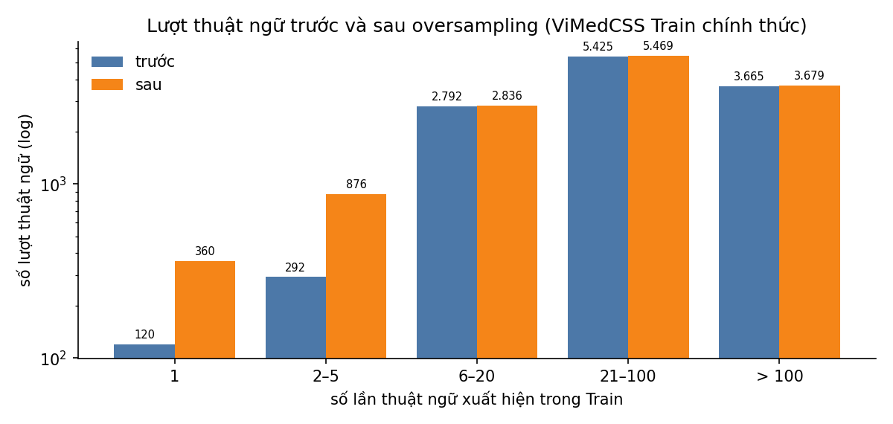

*Hình 14. Lượt thuật ngữ trước và sau oversampling*

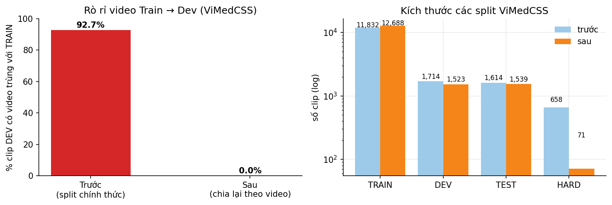

*Hình 5. Rò rỉ video trước và sau khi chia lại*

**Giới hạn nên nói thẳng (không che):** nhóm **chưa áp dụng** class weighting hay focal loss; oversampling thuật ngữ hiếm chỉ có ở V7 và chưa có ablation riêng (O2 và O2R đã có config nhưng chưa chạy). Train vẫn trộn 4 nguồn theo tỷ lệ tự nhiên. Mất cân bằng nguồn (mục 1.3, trục 1) vẫn còn và là hướng cải tiến tiếp theo (xem 3.6). Cải thiện hiện tại đến từ việc xử lý rò rỉ, augmentation và mô hình lớn hơn.

---

## Giai đoạn 2 — Baseline

### 2.1 Thiết lập

Hai baseline đều là **zero-shot** (không huấn luyện), nên các mục LR/optimizer/epochs không áp dụng; điều kiện đồng nhất ở chỗ: cùng dữ liệu, cùng tập DEV, cùng luật chuẩn hóa, cùng cách giải mã greedy, cùng phần cứng.

| | Baseline 1 | Baseline 2 |
|---|---|---|
| Mô hình | PhoWhisper-small (vinai), 244M tham số | Whisper-small (OpenAI, đa ngôn ngữ), 244M tham số |
| Vai trò | mô hình tiếng Việt chuyên biệt | đối chứng khởi tạo: cùng họ/kích thước, không chuyên tiếng Việt |
| Giải mã | greedy, `batch_size 1` | giống Baseline 1 |
| Phần cứng | laptop RTX 4050 6 GB (local), seed 13 | giống |

Môi trường chung cho cả V1…V6: seed 13, LoRA r32/α64/dropout 0,05 trên q,k,v,out_proj,fc1,fc2, hiệu dụng batch 32, fp16. Khác nhau **có chủ đích** ở lr (V1 1e-3, V2 1e-4, V3–V5 3e-4, V6 2e-4), số epoch (3; V6 2) và backbone (V6 medium) — xem bảng 3.3.

### 2.2 Bảng Paper vs Thực nghiệm

Các so sánh dưới đây **chỉ mang tính chỉ báo**, không phải tái lập chính xác: split, chuẩn hóa và metric khác nhau (xem 2.3).

| Mô hình | Nguồn | Dataset / split | WER % | Ghi chú |
|---|---|---|---:|---|
| Baseline 1 PhoWhisper-small zero-shot | Paper (ViMedCSS, arXiv 2602.12911) | ViMedCSS TEST chính thức | 36,31 | arXiv 2602.12911 |
| Baseline 1 | **Nhóm** | ViMedCSS TEST chia theo video (Baseline 1) | **30,02** | thấp hơn 6,3 điểm |
| Baseline 1 | Paper (PhoWhisper) | VIVOS test | 6,33 | arXiv 2406.02555 |
| Baseline 1 | **Nhóm** | VIVOS test | **6,28** | gần như trùng → pipeline đánh giá hợp lý |
| Baseline 1 | Paper (VietMed v4) | VietMed-Test (XLSR-53-Viet, wav2vec2, không phải Whisper) | 29,6 | arXiv 2404.05659; tác giả ghi transcript đã được cập nhật ở bản sau nên số chỉ để tham khảo |
| Baseline 1 | **Nhóm** | VietMed TEST | **25,20** | chỉ báo, chưa xác nhận trùng test chính thức |
| Baseline 2 Whisper-small zero-shot | Paper (ViMedCSS) | ViMedCSS TEST chính thức | 50,03 | Hard 69,20; arXiv 2602.12911, Bảng 4 |
| Baseline 2 | **Nhóm** | ViMedCSS DEV chính thức, không guard / có guard | **46,45 / 40,54** | DEV, không phải TEST; Baseline 2 chưa giải mã TEST |
| Baseline 2 | Paper (Whisper) | FLEURS vi | **chưa tra được** | số nằm ở Appendix D.2.4 của arXiv 2212.04356, không đọc được bản trích; không điền số đoán |
| Baseline 2 | **Nhóm** | FLEURS DEV (có guard) | **25,26** | không guard: 25,61 |
| Baseline 2 | **Nhóm** | DEV tổng (guard / không guard) | **46,59 / 58,75** | VietMed 55,23 / 73,92 do lặp từ và ảo giác |

Hệ thống đề xuất so với paper (cùng bảng ViMedCSS TEST của bài báo):

| Hệ thống | Paper | Nhóm (TEST chia theo video) |
|---|---:|---:|
| zero-shot PhoWhisper-small | 36,31 | 30,02 (Baseline 1) |
| small + LoRA | 27,13 | 18,59 (V3) |
| small + Attention Guide (tốt nhất của bài) | 23,67 | 17,77 (V5) |
| — (paper không có medium + LoRA) | — | **14,78 (V6, medium + LoRA + SpecAugment, beam 5)** |
| Thuật ngữ y khoa: CS-WER tốt nhất | 19,50 | V6 recall 69,2%; CS-WER giảm 56,6% so với zero-shot. Không xếp hạng với paper vì luật tính CS-WER khác (mục 2.5) |

*Lưu ý:* V6 được chốt trên DEV (`reports/final_freeze_20261030/freeze.json`) rồi mới giải mã TEST đúng một lần; tuy vậy TEST của bản chia theo video đã bị xem trong lúc phát triển V3–V5 nên không hoàn toàn "mù". Bảng TEST/HARD V3–V6 ở `tables/test_hard_v3.csv`. So sánh **trên đúng TEST chính thức** của paper là V7 ở mục 3.4 (ViMedCSS TEST 11,40%, HARD 16,42%).

### 2.3 Gap Analysis

**Kết quả có phù hợp với công bố không?** Có ở nơi so được trực tiếp: VIVOS 6,28% so với 6,33% của paper PhoWhisper (chênh 0,05 điểm). Ở ViMedCSS, nhóm thấp hơn paper đáng kể (zero-shot 30,02 so với 36,31; sau LoRA 18,59 so với 27,13). Chênh lệch này **không nên đọc là "tốt hơn paper"**, vì có ba nguyên nhân kết hợp:

1. **Khác dataset/split (domain gap và rò rỉ).** Nhóm chia lại ViMedCSS theo video và **huấn luyện thêm trên VIVOS, FLEURS, VietMed**; paper chỉ dùng ViMedCSS. Thêm thoại y khoa VietMed và dữ liệu đọc rõ làm giảm lỗi chung. Ngược lại, split chính thức có rò rỉ video (mục 1.3), nên nếu dùng split đó số của nhóm còn thấp hơn nữa (V1 18,48% trên DEV chính thức là số lạc quan cho phần ViMedCSS).
2. **Khác kỹ thuật tiền xử lý/chuẩn hóa.** Cách bỏ dấu câu, viết hoa, biến thể chính tả (ví dụ nhãn Train chứa cả *insulin* 56 lần và *inulin* 167 lần, *vaccin* 139 lần và *vắcxin*) ảnh hưởng trực tiếp WER và recall. Đây có thể là nguồn chênh lớn nhất nhưng paper không công bố đủ chi tiết để đối chiếu.
3. **Khác metric.** Paper dùng CS-WER (lỗi trong đoạn code-switch); nhóm dùng WER toàn câu và recall thuật ngữ theo khớp chuỗi con (`cs_term_recall`) — không tương đương.

Siêu tham số (nguyên nhân thứ ba trong yêu cầu) ít ảnh hưởng ở hai baseline vì chúng zero-shot; nó chỉ xuất hiện từ V1 (lr 1e-3 phân kỳ, xem 3.2).

**Điểm yếu cần ghi nhận:** các bản V còn sót khoảng 30% thuật ngữ trên TEST (recall V5 62,6%; V6 69,2%). Con số này không đổi được sang CS-WER 19,5% của paper, nên không dùng để xếp hạng, nhưng vẫn là khoảng trống cần khắc phục.

### 2.4 So sánh với các paper mới (2025–2026)

Các số bên dưới được đọc trực tiếp từ trang arXiv ngày 30/10/2026 (cột "Nguồn kiểm chứng"). **Không có cặp nào so được hoàn toàn trực tiếp**: split, chuẩn hóa và metric khác nhau. Cột cuối nói rõ mức độ so sánh được.

| Paper (thời điểm) | Bài toán / dữ liệu | Kết quả công bố | Kết quả của nhóm | Mức so sánh |
|---|---|---|---|---|
| **ViMedCSS** (arXiv 2602.12911, 13/02/2026) | Vi–En y khoa, TEST chính thức 1.615 clip, 15.820 clip tổng các split | PhoWhisper-small zero-shot WER 36,31 (CS-WER 62,55); +LoRA 27,13 (CS-WER 30,26); +Attention Guide **23,67 (CS-WER 19,50)**; Whisper-large-v3 zero-shot 34,47 (CS-WER 46,69); PhoWhisper-large 31,24; VietASR 27,56; Whisper-small 50,03. Hard: AG 33,73 | **V7 trên TEST/HARD chính thức: 11,40 / 16,42** (CS-WER của nhóm 23,05 / 56,05). Các bản V, TEST chia theo video: Baseline 1 30,02; V3 18,59; V5 17,77; V6 14,78 | **V7: cùng tập test nhưng khác scorer**, nhóm train thêm 3 nguồn và dùng backbone lớn hơn, nên không xếp hạng (xem 3.4). Các bản V: gián tiếp |
| **PhoASR, “Vietnamese ASR: A Revisit”** (arXiv 2603.14779, 16/03/2026; EACL 2026 Findings) | Bộ test “refined” gồm 8 tập, có VietMed-L và VIVOS; WER gốc (O-WER) và chuẩn hóa (N-WER) | VietMed-L: PhoWhisper-small (844h) O-WER 16,58 / N-WER 7,90; PhoASR-small-469h 14,41 / 9,51. VIVOS: PhoWhisper-small 16,54 / 2,69; PhoASR-469h 5,92 / 4,33 | VietMed TEST: Baseline 1 25,20; V5 21,14; V6 19,39. VIVOS test: Baseline 1 6,28; V5 6,57; V6 4,86 | **Không so trực tiếp**: transcript test đã được tinh chỉnh. Chênh lớn (VietMed 7,9 so với 25,2 cho cùng PhoWhisper-small) **phù hợp** với giả thuyết nhãn gốc VietMed nhiễu/lệch biên ở mục 3.2, nhưng chưa phải bằng chứng |
| **TSPC** (arXiv 2509.05983, 09/2025, bản 4 03/2026) | Vi–En code-switching đời thường, CS test 1,18 giờ, không phải y khoa | PhoWhisper-base 27,90; Whisper-large-v3-turbo 31,60; TSPC + SSL P2T + Joint FT **19,06** | Không có số cùng tập | Không so được; chỉ cho thấy mức WER code-switching Vi–En của các hệ thống khác |
| **VietMed** (arXiv 2404.05659, bản 4 sửa 16/10/2026) | VietMed-Test ~6 giờ | XLSR-53 51,8; w2v2-Viet 49,5; **XLSR-53-Viet 29,6** (wav2vec2, không có Whisper) | VietMed TEST: Baseline 1 25,20; V5 21,14; **V6 19,39; V7 20,43** (PhoWhisper-large zero-shot đã 24,04) | Cùng tập test VietMed của nhóm, khác kiến trúc; tác giả ghi transcript đã cập nhật ở bản sau; mốc 29,6 khá thấp vì zero-shot đã vượt |
| **PhoWhisper** (arXiv 2406.02555, 2024) | VIVOS, CMV-vi, VLSP | VIVOS: small **6,33**; medium 4,97; large 4,67 | VIVOS test: chạy lại small **6,28**, large **4,61**; **V6 (medium) 4,86**; V7 7,03 | Trực tiếp: tái lập trùng paper (chênh ≤ 0,06). V6 thấp hơn PhoWhisper-medium của paper (4,97) nhưng **chưa vượt large (4,67)**; V7 chưa vượt |

**Rút ra:**
1. **Trên cùng tập test, WER của V7 thấp hơn số công bố ở 2 trong 3 paper so được:** ViMedCSS (TEST 11,40 so với 23,67; HARD 16,42 so với 33,73) và VietMed (20,43 so với 29,6). **Chưa đạt PhoWhisper-large trên VIVOS** (V7 7,03; V6 4,86 so với 4,67; V6 thấp hơn PhoWhisper-medium 4,97). **Đây là so sánh số, chưa chứng minh phương pháp của nhóm tốt hơn:** V7 lớn hơn (1,55 tỉ so với 244 triệu tham số), train thêm VIVOS/FLEURS/VietMed, và cách chấm khác paper (mục 3.4). Điều bảo vệ được là: huấn luyện thích nghi cải thiện rõ Whisper-large-v3 trong thiết lập này (Whisper-large-v3 zero-shot → V7, cùng dữ liệu và cùng cách chấm).
2. Về thuật ngữ y khoa: CS-WER của V7 giảm 75,8% so với zero-shot chạy lại (paper AG: 68,8% so với zero-shot của paper); hai cách tính CS-WER khác nhau nên hai con số này không dùng để xếp hạng. Các bản V chưa đạt mức này (V6 trên TEST chia theo video: recall 69,2%, CS-WER giảm 56,6%).
3. Paper mới nhất về ASR tiếng Việt (PhoASR) chỉ ra rằng **chất lượng transcript** ảnh hưởng rất lớn đến điểm số; điều này ủng hộ ưu tiên xây tập đánh giá nhãn sạch (mục 3.6).

**Đã tìm nhưng không dùng:** (i) một mô hình PhoWhisper-large + LoRA cho code-switching Vi–En trên Hugging Face, trích dẫn bài ở KES 2026 (Procedia Computer Science) — chỉ thấy thẻ mô hình, chưa đọc được bài nên không đưa số; (ii) câu “Whisper 24,03 → 15,47 → 13,91 WER trên VietMed” xuất hiện trong một bản tóm tắt tìm kiếm nhưng **không có** trong bài VietMed (bản 4), nên không dùng.

### 2.5 So sánh cùng bộ metric với paper ViMedCSS

Paper báo cáo bốn metric: **WER, CER, CS-WER, N-WER**. Nhóm tính lại cả bốn trên `predictions.jsonl` (`scripts/build_same_metric_table.py`, chỉ lấy clip ViMedCSS). Hai điều cần nói trước:

1. **WER và CER là cùng định nghĩa chuẩn** (nhóm: chuẩn hóa NFC, chữ thường, bỏ dấu câu; paper không nêu cách chuẩn hóa). Tập test thì khác: paper dùng TEST chính thức (1.615 clip), nhóm dùng TEST chia theo video (1.539 clip, 0 video trùng Train).
2. **CS-WER không tái tạo được chính xác.** Paper chỉ mô tả “WER chỉ trên token trong vùng code-switch”, không có công thức, luật căn chỉnh hay luật tính chèn. Nhóm hiểu là: căn chỉnh từ bằng jiwer, từ tham chiếu thuộc `cs_terms` là từ code-switch, lỗi thay thế/xóa tính vào từ tham chiếu, lỗi chèn tính vào từ tham chiếu đứng trước. **Kiểm tra cho thấy cách hiểu này khắt khe hơn paper**: cùng PhoWhisper-small zero-shot, paper ra 62,55% còn nhóm ra 94,60%. Vì vậy CS-WER tuyệt đối của nhóm **không so được** với paper. Mức giảm so với zero-shot cùng tập có ý nghĩa trong nội bộ nhóm; đặt cạnh mức giảm của paper chỉ để tham khảo, vì luật tính khác nhau. N-WER của paper cũng không tái tạo được (WER của paper nhỏ hơn cả CS-WER lẫn N-WER ở dòng LoRA, điều không xảy ra nếu hai metric chia đều tổng lỗi), nên không đưa N-WER vào bảng.

**TEST** (số paper: Bảng 4–6; số nhóm: ViMedCSS trong TEST chia theo video):

| Hệ thống | WER % | CER % | CS-WER % | Giảm CS-WER so với zero-shot cùng tập |
|---|---:|---:|---:|---:|
| Paper · PhoWhisper-small zero-shot | 36,31 | 22,64 | 62,55 | — |
| Paper · small + LoRA | 27,13 | 18,01 | 30,26 | 51,6% |
| Paper · small + Attention Guide (tốt nhất) | 23,67 | 14,73 | 19,50 | 68,8% |
| Paper · PhoWhisper-large zero-shot | 31,24 | 19,25 | 55,05 | 12,0% |
| Paper · Whisper-large-v3 zero-shot | 34,47 | 24,61 | 46,69 | 25,4% |
| **Nhóm · Baseline 1 (small zero-shot)** | 30,02 | 21,26 | 94,60* | — |
| **Nhóm · V3 (small + LoRA)** | 18,59 | 13,33 | 52,82* | 44,2% |
| Nhóm · V5 (small + LoRA + SpecAugment + beam 5) | 17,77 | 12,76 | 46,36* | 51,0% |
| **Nhóm · V6 (medium, beam 5), chốt trước TEST** | **14,78** | **10,90** | **41,08*** | **56,6%** |

**DEV chia theo video** (so với Baseline 1 cùng DEV):

| Hệ thống | WER % | CER % | CS-WER % | Giảm CS-WER so với zero-shot cùng tập |
|---|---:|---:|---:|---:|
| Nhóm · Baseline 1 | 29,05 | 20,73 | 99,42* | — |
| Nhóm · V5 | 15,40 | 11,28 | 41,95* | 57,8% |
| **Nhóm · V6 (medium, beam 5), mô hình tốt nhất** | **12,72** | **9,41** | **34,52*** | **65,3%** |

\* CS-WER theo cách tính của nhóm, chỉ so tương đối.

**HARD:** không đưa vào bảng so sánh. Hard của paper (658 clip, chỉ chứa thuật ngữ xuất hiện một hai lần trong cả corpus) khác Hard của nhóm (71 clip, tạo sau khi chia lại theo video). Số của nhóm có trong `tables/same_metric_ours.csv`.

**Đọc kết quả:**
- **WER và CER: số của nhóm thấp hơn số công bố.** V6 đạt WER 14,78% / CER 10,90% (V5 17,77% / 12,76%) so với 23,67% / 14,73% của hệ tốt nhất trong paper, nhưng hai bên chấm trên hai tập test khác nhau nên chưa kết luận được bên nào tốt hơn. WER giảm 50,8% so với zero-shot cùng tập (V5 40,8%; paper 34,8%), một phần nhờ nhóm train thêm VIVOS, FLEURS và VietMed. CER zero-shot gần nhau (21,26% so với 22,64%) chỉ là một quan sát, không chứng minh hai tập có độ khó tương đương. WER zero-shot lệch 6 điểm (30,02% so với 36,31%) có thể đến từ cách chuẩn hóa văn bản, nhưng chưa kiểm chứng.
- **Thuật ngữ y khoa (CS-WER): chưa xếp hạng được với paper.** Trên TEST, V6 giảm 56,6% (V5 51,0%); LoRA của paper giảm 51,6%, AG 68,8%, theo luật tính CS-WER khác. Trên DEV V6 giảm 65,3%; mức giảm trên TEST thấp hơn DEV khoảng 9 điểm.
- **Điều kiện để kết luận chắc hơn:** chạy mô hình của nhóm trên đúng TEST và Hard chính thức của paper. V3 trở đi đã train trên cả clip thuộc TEST chính thức nên không dùng được cho việc này; nhóm train mô hình mới **V7** chỉ trên Train chính thức, kết quả ở mục 3.4.

---

## Giai đoạn 3 — Phương pháp đề xuất

### 3.1 V1: PhoWhisper-small + LoRA trên 4 nguồn

Điểm cải tiến so với baseline: LoRA r32 (trainable 52 MB) trên cả attention và FFN, huấn luyện trộn 4 nguồn, nhãn chuẩn hóa cùng luật chấm điểm.

**DEV chính thức (5.168 clip):**

| | WER % | CER % | Recall thuật ngữ | FLEURS | VIVOS | ViMedCSS | VietMed |
|---|---:|---:|---:|---:|---:|---:|---:|
| Baseline 1 | 24,73 | 19,25 | 13,0% | 10,89 | 0,42 | 28,36 | 25,87 |
| Baseline 2 | 58,75 | 46,35 | 16,1% | 25,61 | 20,45 | 46,46 | 73,92 |
| **V1** | **18,48** | 14,36 | **71,3%** | 11,12 | 6,92 | 16,10 | 21,80 |

**Tín hiệu cải thiện:** V1 giảm 6,25 điểm WER so với Baseline 1 (−25% tương đối) và 40,3 điểm so với Baseline 2. Thuật ngữ y khoa tăng từ 13,0% lên 71,3%. Cải thiện tập trung ở **ViMedCSS (−12,3 điểm)** và **VietMed (−4,1 điểm)**, đúng miền đích. **Cái giá:** VIVOS xấu đi mạnh (0,42 → 6,92) và FLEURS không đổi (10,89 → 11,12); nguyên nhân chính là lr 1e-3 làm huấn luyện phân kỳ giữa chừng (`fig9_training_curves.png`: loss 0,4 → 4,6, WER DEV-subset tới 320% ở bước ~700) rồi chỉ phục hồi khi lr giảm.

**Trực quan hóa:** đường cong loss/WER ở `fig9_training_curves.png`. Confusion Matrix kiểu phân loại **không áp dụng cho ASR**; thay bằng (a) cơ cấu lỗi thay thế/xóa/chèn (V1: 10.344 / 7.626 / 5.675; `fig7_error_breakdown.png` vẽ các bản Baseline 1 → V6, không có V1) và (b) ma trận nhầm lẫn theo cặp từ (`fig10_top_confusions.png`, `tables/top_substitutions.csv`, của V6 trên DEV). Grad-CAM/attention map: không thực hiện (đề bài ghi "nếu có").

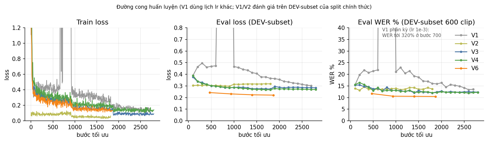

*Hình 6. Đường cong loss và WER trong huấn luyện*

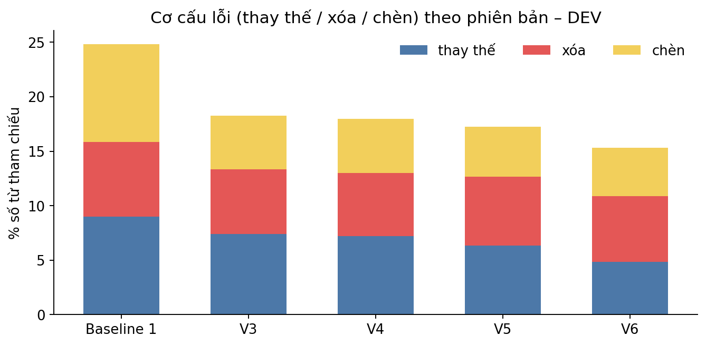

*Hình 7. Cơ cấu lỗi thay thế, xóa, chèn*

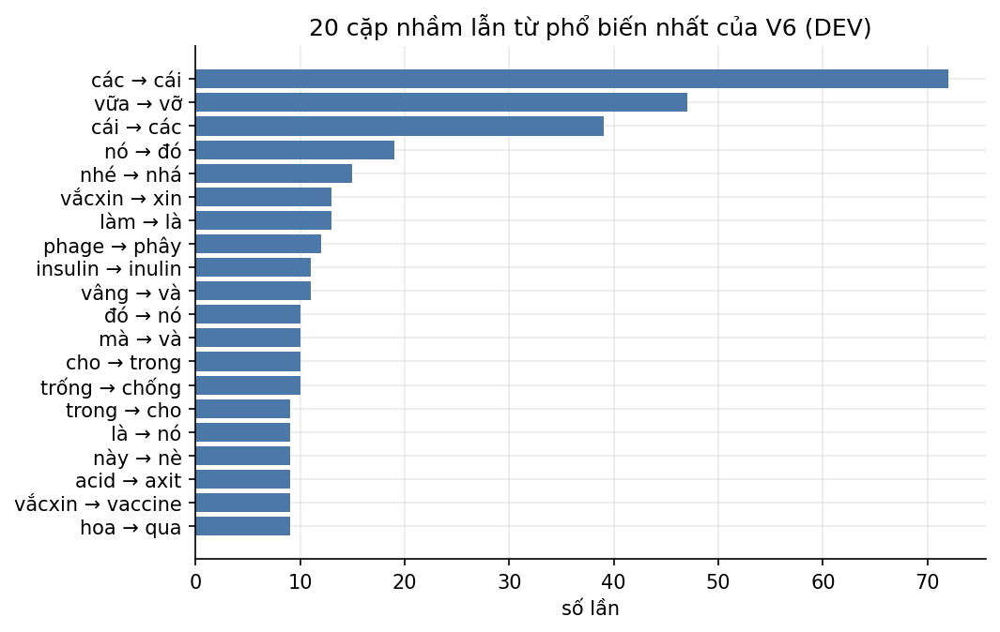

*Hình 8. Các cặp từ hay nhầm nhất*

### 3.2 Phân tích lỗi (Failure cases)

Dùng V6 (mô hình tốt nhất) trên DEV chia theo video để có phân tích gần với sản phẩm cuối; V1 có cùng dạng lỗi, xem handover §4. Tổng **18.981 lỗi từ** trên 4.978 clip; 579 clip (11,6%) đúng hoàn toàn.

| Loại | Clip | % tổng số lỗi | Nhận xét |
|---|---:|---:|---|
| Lệch biên đầu/cuối clip | 1.811 | **52,7%** | mô hình nghe thêm câu ở đầu/cuối mà nhãn không có (hoặc ngược lại) |
| Thay thế rải rác | 1.786 | 34,8% | nghe nhầm từ, thuật ngữ, từ chức năng |
| Chèn là chính (thừa/lặp) | 341 | 6,6% | lặp từ, ảo giác (vòng lặp) |
| Xóa là chính (mất đoạn) | 461 | 5,9% | bỏ nguyên đoạn |

Theo nguồn (`fig11_failure_categories.png`): **VietMed chiếm 69,3% tổng số lỗi** (dù chỉ 55,6% số từ DEV), ViMedCSS 27,1%, FLEURS 3,4%, VIVOS 0,2%. Trong VietMed, **68,3% lỗi nằm ở biên clip**.

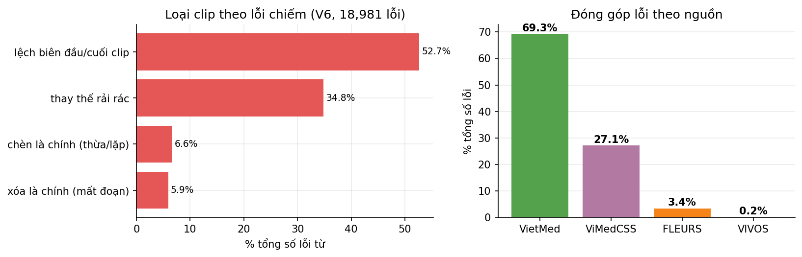

*Hình 9. Loại lỗi theo nguồn*

**Nguyên nhân cốt lõi (có bằng chứng, chưa kiểm chứng bằng nghe lại audio):**

1. **Nhãn không khớp phạm vi audio (≈ 53% lỗi).** Ví dụ ViMedCSS: nhãn dừng sau *"…lấy một lượng vaseline"* nhưng mô hình nghe tiếp *"chúng ta bôi lên môi sau đó…"*. Ví dụ VietMed: nhãn *"…rối loạn thị giác"*, hệ thống ra *"…rối loạn về thị giác tuy nhiên thì…"*. Câu mô hình thêm vào có vẻ hợp lý, nên **giả thuyết** là nhiều lỗi nhóm này đến từ nhãn thiếu hoặc cắt đoạn lệch. Giả thuyết chưa được xác nhận vì chưa nghe lại audio; cũng có thể là mô hình chèn sai. Nếu đúng, WER trên VietMed (19,08%) bị đẩy cao và khó giảm bằng huấn luyện thêm. Để kiểm chứng cần nghe một mẫu clip chọn ngẫu nhiên và phân loại: nhãn thiếu, mô hình chèn sai, cắt đoạn lệch, không rõ.
2. **Thuật ngữ y khoa hiếm và tên riêng.** Recall 72,5% (440/1.602 lượt bị mất). Hay mất nhất: *phage* 0/20, *tarlov* 0/16, *wegener* 0/9, *bernard* 0/9, *carnitin* 0/7, *digeorge* 10/27 — chủ yếu tên riêng/bệnh mang tên người và hóa chất. Thuật ngữ chưa từng thấy chỉ recall 20,8% so với 75,8% đã thấy.
3. **Nhãn không nhất quán.** *insulin → inulin* (11 lần), *vắcxin → xin*: nhãn Train chứa cả *insulin* (56 lần) và *inulin* (167 lần), và cả *vaccin* lẫn *vắcxin*. Chưa phân biệt được đây là biến thể chính tả hay hai chất khác nhau, nhưng mô hình học theo kiểu phổ biến hơn và bị tính sai.
4. **Từ chức năng đồng âm.** *các ↔ cái* (72 + 39 lần), *vữa → vỡ* (47 lần, trong "xơ vữa"): nhầm theo ngữ cảnh, không phải mất âm.
5. **Chuẩn hóa số.** FLEURS: nhãn "100 feet", mô hình ra "một trăm feet"; luật chuẩn hóa chưa đưa số về một dạng.
6. **Vòng lặp khi giải mã beam.** Ví dụ FLEURS: "nhnhnh…" (clip bị cắt). Beam 5 làm tăng số clip bị cắt (TEST: greedy 2 → V5 13 clip, đóng góp +0,23 điểm WER: 17,38% → 17,15% nếu thay các clip bị cắt bằng kết quả greedy); guard chỉ giới hạn độ dài.

Nguyên nhân đặc trưng của V1 (khác V6): lr 1e-3 phân kỳ → VIVOS tăng 0,42 → 6,92%; đã sửa ở V2/V3 bằng lr thấp hơn.

### 3.3 Bảng tiến trình V1 → V6

DEV chính thức (5.168 clip):

| Phiên bản | Thay đổi so với bản trước | Lý do (từ phân tích lỗi) | WER % | Nhận xét |
|---|---|---|---:|---|
| Baseline 1 | PhoWhisper-small zero-shot | baseline | 24,73 | thuật ngữ y khoa 13,0% |
| Baseline 2 | Whisper-small zero-shot | đối chứng | 58,75 | lặp, ảo giác; guard → 46,59 |
| **V1** | + LoRA r32, lr 1e-3, 4 nguồn | thích nghi miền y khoa | **18,48** | −6,25 so với Baseline 1; lr phân kỳ |
| V2 | V1 → huấn luyện tiếp, lr 1e-4 | V1 chỉ khá khi lr giảm | 19,08 | **không cải thiện** (guard: 18,62 so với V1 có guard 18,40) → bỏ hướng "tiếp tục" |

DEV chia theo video (4.978 clip, ViMedCSS chia theo video):

| Phiên bản | Thay đổi | Lý do | WER % | Δ so với bản trước | Recall | Nhận xét |
|---|---|---|---:|---:|---:|---|
| Baseline 1 | baseline trên DEV chia theo video | đối chiếu sạch | 24,83 | — | 9,1% | |
| V3 | chia lại ViMedCSS theo video, lr 3e-4 từ model gốc | rò rỉ video 92,7%; lr 1e-3 phân kỳ | 18,26 | −6,57 | 60,1% | số sạch, không lạc quan; VIVOS về 2,05 |
| V4 | V3 + SpecAugment | V3 quá khớp (WER DEV-subset chạm đáy ở bước 1800 rồi đi ngang) | 17,96 | −0,30 [−0,54; −0,05] (bootstrap) | 62,5% | |
| V5 | V4 + beam 5 | | 17,26 | −1,01 so với V3 [−1,22; −0,80] | 66,4% | tốt nhất trong nhóm small |
| **V6** | backbone **PhoWhisper-medium** (769M), 2 epoch, lr 2e-4, beam 5, base fp16 | lỗi còn lại là thuật ngữ hiếm và VietMed; paper cho thấy lớn hơn → tốt hơn | **15,33** | −1,93 so với V5 | **72,5%** | **tốt nhất**, mọi nguồn đều giảm |

Bảng đầy đủ: `tables/ablation_dev_official.csv`, `tables/ablation_dev_v3.csv`.

**Ablation 2×2 (small, DEV chia theo video):**

| | greedy | beam 5 |
|---|---:|---:|
| không SpecAugment | 18,26 | 17,44 |
| SpecAugment | 17,96 | 17,26 |

Hai kỹ thuật cộng dồn gần như độc lập (−0,30 và −0,83 → −1,01). Với medium, beam chỉ thêm 0,34 điểm (15,67 → 15,33) so với 0,70 ở small.

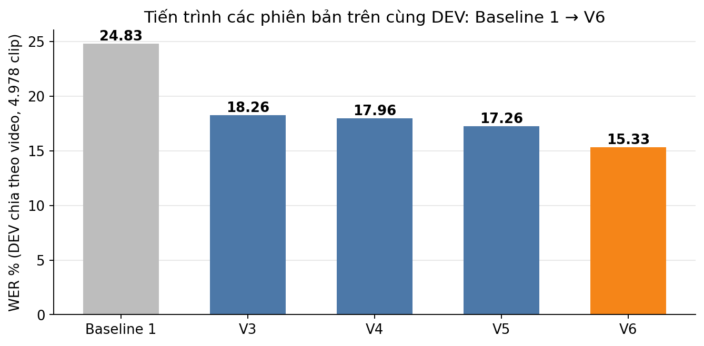

*Hình 10. Ablation trên DEV chia theo video*

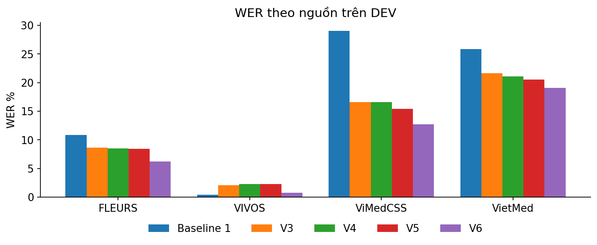

*Hình 11. WER theo nguồn*

**TEST và HARD chia theo video** (V6 chốt trên DEV trước khi giải mã; `tables/test_hard_v3.csv`):

| Phiên bản | TEST tổng | ViMedCSS | VietMed | VIVOS | FLEURS | Recall thuật ngữ | Clip bị cắt | HARD (71 clip) |
|---|---:|---:|---:|---:|---:|---:|---:|---:|
| Baseline 1 | 23,22 | 30,02 | 25,20 | 6,28 | 12,20 | 13,7% | 1 | 39,68 |
| V4 | 17,88 | 17,97 | 21,89 | 6,66 | 9,18 | 59,2% | 2 | 20,00 |
| V5 | 17,38 | 17,77 | 21,14 | 6,57 | 8,86 | 62,6% | 13 | 23,42 |
| **V6** | **15,16** | **14,78** | **19,39** | **4,86** | **6,24** | **69,2%** | 9 | **16,39** |

Thứ hạng trên TEST giống DEV: V6 tốt nhất, V6 so với V5 giảm 2,22 điểm (DEV 1,93). Mọi nguồn đều giảm. Beam làm tăng clip bị cắt: V4 có 2 clip, V5 có 13 clip, V6 có 9 clip. HARD chỉ có 71 clip nên dao động lớn (V5 tệ hơn V4), không dùng để chọn mô hình.

**Hai điều cần ghi rõ để tránh hiểu sai:**
- V6 so với V5 đổi **nhiều biến cùng lúc** (backbone, lr 2e-4 thay 3e-4, 2 epoch thay 3, batch vi mô 2 × 16): không thể quy toàn bộ −1,93 điểm cho kích thước mô hình, dù đó là giả thuyết hợp lý nhất.
- Mô hình/cấu hình được chọn bằng DEV; TEST của bản chia theo video đã bị xem trong lúc phát triển V3–V5 nên không còn là số "mù" (V6 được chốt trước khi giải mã TEST, nhưng hướng đi V6 vẫn được chọn sau khi đã thấy TEST của V3–V5). Để chấm được trên đúng tập test của paper, nhóm train thêm V7 trên split chính thức (mục 3.4).

### 3.4 V7: train trên split chính thức để chấm trên đúng tập test của paper

**Vì sao cần.** Các bản V3 đến V6 train trên ViMedCSS chia theo video, tức đã thấy clip thuộc TEST chính thức, nên không chấm được trên tập test của paper. V7 chỉ dùng phần **Train chính thức** của 4 nguồn để giải mã được trên đúng TEST (1.614 clip ViMedCSS) và HARD (658 clip) của paper, cùng VIVOS test (PhoWhisper) và VietMed test (VietMed).

**Thiết lập** (`experiments/O3W_whisper_large_v3_lora_official_termos/config.yaml`):

| Hạng mục | V7 |
|---|---|
| Backbone | Whisper-large-v3 (1,55 tỉ tham số), đóng băng; chọn vì là zero-shot có CS-WER tốt nhất trong paper (46,69) |
| Fine-tune | LoRA r32/α64/dropout 0,05 trên q, k, v, out_proj, fc1, fc2 (như V1–V6); SpecAugment 5%/5% (như V4) |
| Mới | Oversampling thuật ngữ hiếm (mục 1.4): 407 clip × 3 → Train 29.864 clip |
| Huấn luyện | Colab A100 80 GB, bf16, batch 32, lr 1e-4, warmup 5%, 2 epoch (1.868 bước), khoảng 2,1 giờ; đánh giá DEV-subset mỗi epoch |
| Giải mã | guard như V3 trở đi (bỏ clip im lặng, token ≤ 12/giây + 20); greedy hoặc beam 5 |
| Chốt mô hình | chọn cách giải mã trên DEV chính thức; ghi `reports/final_freeze_official/freeze.json` (config, sha256 adapter `d77693ec…`) lúc 05:14:49, **trước** lần giải mã HARD đầu tiên (05:19) và TEST (log `runs.jsonl`) |

**DEV chính thức (5.168 clip, cùng tập với V1):**

| | WER % | ViMedCSS % | VietMed % | FLEURS % | VIVOS % | Recall thuật ngữ |
|---|---:|---:|---:|---:|---:|---:|
| V1 (small, lr 1e-3) | 18,48 | 16,10 | 21,80 | 11,12 | 6,92 | 71,3% |
| V7 greedy | 15,52 | 12,15 | 19,58 | 6,50 | 6,48 | 79,2% |
| **V7 beam 5 (chọn)** | **15,07** | **11,38** | **19,27** | **6,35** | **6,23** | **81,3%** |

**TEST/HARD chính thức, riêng ViMedCSS** (cùng bộ metric với paper; `tables/same_metric_official.csv`, `figures/fig14_official_vs_paper.png`):

| Hệ thống | TEST WER | TEST CER | TEST CS-WER* | HARD WER | HARD CER | HARD CS-WER* |
|---|---:|---:|---:|---:|---:|---:|
| Paper · PhoWhisper-small zero-shot | 36,31 | 22,64 | 62,55 | 46,27 | 28,11 | 66,01 |
| Paper · PhoWhisper-large zero-shot | 31,24 | 19,25 | 55,05 | 37,37 | 23,02 | 57,37 |
| Paper · Whisper-large-v3 zero-shot | 34,47 | 24,61 | 46,69 | 39,35 | 27,46 | 50,10 |
| Paper · small + LoRA | 27,13 | 18,01 | 30,26 | 37,27 | 24,55 | 60,71 |
| Paper · small + Attention Guide (tốt nhất) | 23,67 | 14,73 | 19,50 | 33,73 | 21,48 | 57,29 |
| Nhóm chạy lại · PhoWhisper-small zero-shot | 28,02 | 19,76 | 95,19 | 36,04 | 25,18 | 99,24 |
| Nhóm chạy lại · PhoWhisper-large zero-shot | 23,14 | 16,56 | 82,65 | 27,14 | 19,47 | 81,99 |
| Nhóm chạy lại · Whisper-large-v3 zero-shot | 29,61 | 22,85 | 65,89 | 33,14 | 25,04 | 71,54 |
| **Nhóm · V7 (beam 5)** | **11,40** | **8,48** | 23,05 | **16,42** | **11,80** | 56,05 |

\* CS-WER của nhóm theo cách tính ở mục 2.5, khắt khe hơn paper khoảng 1,4–1,5 lần trên cùng mô hình zero-shot; không so trực tiếp với cột CS-WER của paper.

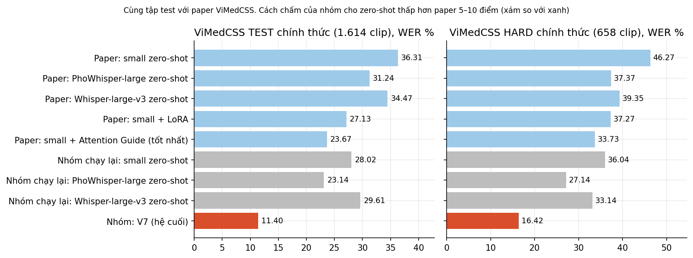

*Hình 12. WER trên TEST và HARD chính thức. Cách chấm của nhóm và của paper khác nhau, xem mục đọc kết quả*

**Các corpus khác trên cùng lần giải mã TEST** (`tables/official_test_by_source.csv`):

| Tập test (paper) | Paper | Nhóm chạy lại zero-shot | V7 |
|---|---:|---:|---:|
| VIVOS test (PhoWhisper) | small 6,33; large **4,67** | small 6,28; large **4,61** | 7,03 |
| VietMed test (VietMed, XLSR-53-Viet) | 29,6 | small 25,19; large 24,04 | **20,43** |
| FLEURS test | không có số paper | large 8,36; large-v3 8,36 | **6,97** |

**Đọc kết quả, kèm kiểm tra độ tin cậy:**
1. **Cách chấm của nhóm cho WER thấp hơn paper** trên cùng mô hình zero-shot: TEST thấp hơn 4,9–8,3 điểm, HARD thấp hơn 6,2–10,2 điểm (nhiều khả năng do chuẩn hóa văn bản; paper không công bố cách chuẩn hóa). Kiểm tra độ nhạy thô: cộng chênh lệch lớn nhất vào V7 được TEST 19,7 và HARD 26,7, so với 23,67 và 33,73 của AG. **Phép cộng này không chứng minh V7 vượt AG**, vì tác động của chuẩn hóa phụ thuộc loại lỗi của từng mô hình. Mức giảm so với zero-shot cũng chỉ có ý nghĩa nội bộ: V7 giảm 59,3% WER TEST so với Baseline 1 và 54,4% WER HARD (paper AG: 34,8% và 27,1%, theo cách chấm của paper). Muốn so trực tiếp phải chấm các hệ trên cùng transcript, cùng luật chuẩn hóa và cùng scorer. Nhóm không có transcript đầu ra của hệ AG nên số của AG chỉ được trích lại, không xếp hạng với V7.
2. **Rò rỉ video trong split chính thức.** 1.513/1.613 clip TEST được chấm (1 clip audio rỗng bị bỏ) và 388/658 clip HARD thuộc video có trong Train chính thức (mục 1.3). Paper train trên cùng split nên chịu cùng điều kiện. Chỉ xét clip thuộc video **không** có trong Train: V7 đạt TEST 15,96% (100 clip, Baseline 1 31,73%) và HARD 18,80% (270 clip, Baseline 1 35,00%). Mức giảm so với Baseline 1 còn 46–50% (so với khoảng 60% trên clip có video trùng). Đây là quan sát nội bộ, phù hợp với giả thuyết rò rỉ có giúp, nhưng chưa đo được tác dụng vì hai nhóm clip có thể khác độ khó, và tập 100 clip không so được với kết quả toàn TEST của paper.
3. **Thuật ngữ y khoa.** Recall thuật ngữ trên TEST 79,9% (Whisper-large-v3 zero-shot 39,7%); CS-WER giảm 75,8% so với Baseline 1 và 65,0% so với Whisper-large-v3 zero-shot (cùng backbone). Trên HARD, recall chỉ 50,3% và CS-WER 56,05%: thuật ngữ cực hiếm vẫn là điểm yếu. Recall ở đây khớp chuỗi con nên là cận trên; khớp nguyên từ cho TEST 69,9% và HARD 45,8%. Phần chênh chủ yếu là biến thể chính tả (*vaccin* trong *vaccine*), nên giá trị thật nằm giữa hai cận. Oversampling lặp lại thuật ngữ có trong Train nên không trực tiếp giúp thuật ngữ chưa thấy: 249/338 thuật ngữ HARD (475/758 lượt) không xuất hiện trong transcript Train của cả 4 nguồn.
4. **VIVOS chưa đạt mức PhoWhisper.** V7 cải thiện Whisper-large-v3 từ 12,28 xuống 7,03 nhưng vẫn cao hơn PhoWhisper (4,61–6,28), mô hình đã học VIVOS từ trước (mục 1.3). Hướng thử tiếp là PhoWhisper-large + LoRA (O3P, đã có config, chưa train).
5. **Điều kiện khác paper.** V7 lớn gấp khoảng 6 lần PhoWhisper-small và train thêm VIVOS/FLEURS/VietMed; V7 đổi nhiều biến cùng lúc (backbone, split, oversampling, lr) và chưa có ablation riêng cho oversampling (O2 và đối chứng cùng số bước O2R đã có config nhưng chưa chạy). Vì vậy chưa nói được tác dụng của từng thành phần.

### 3.5 Thử nghiệm sơ bộ: tác dụng của rò rỉ video

**Câu hỏi.** Mục 1.3 cho thấy split chính thức có nhiều clip cùng video ở cả Train và tập chấm. Để clip cùng video vào Train làm điểm số đẹp lên bao nhiêu?

**Thiết kế** (kế hoạch ghi trước khi chạy: `reports/paper/PAPER_PLAN.md`):
- Hai bộ Train cùng 29.913 clip, khác nhau ở 722 clip: bản sạch lấy từ video khác, bản rò rỉ lấy từ chính các video trong tập chấm.
- Tập chấm dùng chung: `probe_seen` (809 clip, 192 video, có clip cùng video trong Train rò rỉ) và `probe_unseen` (1.409 clip, 179 video, đối chứng).
- Chỉ số chính là difference-in-differences (DiD): mức giảm WER trên `probe_seen` trừ mức giảm WER trên `probe_unseen`. Khoảng tin cậy 95% bằng bootstrap ghép cặp theo video.
- Mô hình PhoWhisper-small + LoRA, 3 epoch (2.802 bước), batch hiệu dụng 32. Kế hoạch là 3 seed; **nhóm chỉ hoàn thành seed 13** (laptop RTX 4050, 5 giờ 52 phút mỗi lần chạy) rồi dừng để viết báo cáo. Seed 14 dừng giữa chừng và không được giải mã.

**Kết quả seed 13:**

| Chỉ số | `probe_seen`: sạch → rò rỉ | `probe_unseen`: sạch → rò rỉ | DiD | Khoảng tin cậy 95% |
|---|---|---|---:|---|
| WER % (chỉ số chính) | 18,00 → 17,50 | 14,93 → 14,74 | +0,30 | −0,63 đến +1,14 |
| Recall thuật ngữ %, khớp nguyên từ | 51,90 → 62,23 | 54,00 → 54,80 | +9,53 | +4,39 đến +14,69 |
| Recall thuật ngữ %, khớp chuỗi con | 60,45 → 71,02 | 63,06 → 62,73 | +10,91 | +6,25 đến +15,83 |

**Đọc kết quả:**
- **WER:** khoảng tin cậy chứa 0, nên chưa có bằng chứng rò rỉ làm WER tốt lên trong cấu hình này. Điều đó không có nghĩa là rò rỉ không có tác dụng. Tiêu chí đã ghi trước yêu cầu khoảng tin cậy nằm trên 0 ở cả 3 seed, nên kết quả này chưa trả lời được câu hỏi chính.
- **Recall thuật ngữ:** tăng khoảng 10 điểm ở `probe_seen`, gần như không đổi ở `probe_unseen`. Thuật ngữ chỉ chiếm khoảng 4% số từ của `probe_seen` (842/20.044), nên thay đổi này gần như không hiện lên WER.

**Giới hạn:**
- Recall là chỉ số **được thêm sau khi thấy dữ liệu** seed 13, không nằm trong tiêu chí ban đầu, nên chỉ là kết quả thăm dò.
- Chỉ có một seed, và khoảng tin cậy chỉ đo bất định do mẫu video, không gồm dao động giữa các lần train.
- Mức tăng tập trung: 10 thuật ngữ đóng góp 63/87 lượt tăng ròng (khớp nguyên từ) trên `probe_seen`. Tối đa 26 lượt có thể đến từ thuật ngữ mới vào từ vựng Train (802 → 828 trên 842 lượt), phần còn lại chưa được giải thích.
- 722 clip thêm và 722 clip bỏ gần nhau về thời lượng (1,41 / 1,42 giờ) và số từ mỗi clip (26,1 / 26,8), nhưng khác về số thuật ngữ phân biệt (210 / 306).
- Thí nghiệm không tách được đóng góp của người nói, âm học, chủ đề hay thuật ngữ, và mới đo trên một corpus.

Vì vậy mục 3.4 vẫn giữ nguyên nhận định: chưa đo được tác dụng của rò rỉ lên số V7.

### 3.6 Tính khả thi của sản phẩm cuối

| Tiêu chí | V5 (small) | **V6 (medium, beam 5)** |
| --- | ---: | ---: |
| WER trên DEV | 17,26% | **15,33%** |
| WER trên TEST (ViMedCSS) | 17,38% (17,77%) | **15,16% (14,78%)** |
| Recall thuật ngữ DEV / TEST | 66,4% / 62,6% | 72,5% / 69,2% |
| Tham số backbone | 244M | 769M |
| Adapter LoRA | 52 MB | 139 MB |
| RTF giải mã (RTX 4050 6 GB) | 0,208 | 0,321 |
| VRAM đỉnh khi suy luận | 2,1 GB | 3,8 GB |
| VRAM đỉnh khi huấn luyện | 4,1 GB | 4,3 GB |
| Thời gian huấn luyện (laptop) | không tổng hợp | **~8,5 giờ** (1.868 bước) |

(Số liệu từ `tables/latency_size.csv`; RTF đo chỉ phần giải mã, batch 1, GPU laptop có duty cycle 0,7 — chậm hơn máy chủ.)

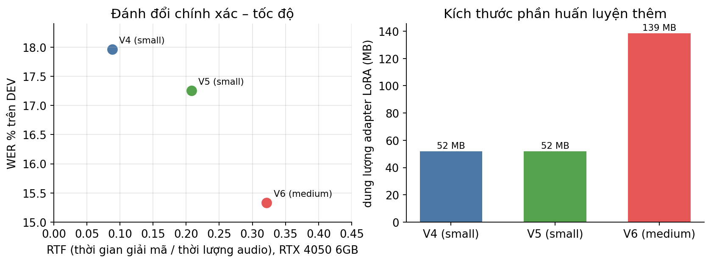

*Hình 13. Độ chính xác, tốc độ và kích thước*

**Kết luận: KHẢ THI CÓ ĐIỀU KIỆN** để đóng gói ở Task 3.
- **Độ chính xác:** 15,3% WER trên DEV và 15,2% trên TEST (đều sạch rò rỉ video), recall thuật ngữ 72,5% / 69,2% — dùng được cho gõ nháp/tóm tắt ghi âm có người soát lại, **chưa đủ** cho văn bản y khoa không cần soát vì còn sót khoảng 3/10 thuật ngữ.
- **Tốc độ:** RTF 0,21–0,32 nghĩa là phần giải mã clip có sẵn nhanh hơn thời gian thực 3–5 lần trên GPU laptop 6 GB → phù hợp xử lý theo lô. RTF này không gồm các bước khác của hệ thống và chưa chứng minh chạy được streaming. Chưa đo trên CPU/di động; model 769M không phù hợp edge nếu không lượng tử hóa.
- **Kích thước:** adapter 139 MB + backbone fp16 1,5 GB; chạy được trên GPU ≥ 4 GB.
- **V7 (mục 3.4)** là hệ tốt nhất trên split chính thức (DEV 15,07%, recall 81,3%; TEST ViMedCSS 11,40%), không so trực tiếp với V6 vì khác split, và nặng hơn: backbone 1,55 tỉ tham số (fp16 khoảng 3,1 GB) + adapter 231 MB; RTF 0,037 trên A100 (beam 5, batch 16), **chưa đo** trên GPU laptop 6 GB; không so trực tiếp với RTF của V6 vì khác GPU và batch. Lựa chọn đóng gói ở Task 3: V6 nếu cần chạy trên máy nhỏ, V7 nếu có GPU ≥ 8 GB (cần đo lại).
- **Điều kiện/rủi ro cần xử lý trước khi phát hành:** (i) clip bị cắt/lặp khi dùng beam → thêm cơ chế rơi về greedy; (ii) thuật ngữ hiếm và tên riêng (V7 vẫn sót 20% thuật ngữ trên TEST, 50% trên HARD) → từ điển y khoa, hiệu chỉnh hậu kỳ hoặc RAG; (iii) nghi có nhiễu nhãn VietMed (chưa xác nhận) khiến đo chất lượng khó → lập tập đánh giá nhãn sạch (nghe lại ~500 clip).

**Việc chưa làm và hướng tiếp theo (theo mức ưu tiên):**
1. Hoàn tất nghiên cứu rò rỉ: đủ 3 seed trên cùng một máy (ước tính khoảng 3 giờ A100, chưa đo).
2. Ablation O2 và O2R để đo riêng tác dụng của oversampling; ablation nguồn dữ liệu D1–D4.
3. PhoWhisper-large + LoRA (O3P) cho VIVOS.
4. Từ điển thuật ngữ, chuẩn hóa số và biến thể chính tả. Kết quả đo trên DEV cho thấy với từ điển độc lập (Train + MeSH 2026), thuật ngữ chưa thấy chỉ lọt vào danh sách 30 mục ở 17,7% số lượt, nên hướng này khó cứu thuật ngữ chưa thấy nếu không có từ điển tốt hơn.
5. Nghe lại 300–500 clip chọn ngẫu nhiên, 2 người gán độc lập, tính Cohen's Kappa để kiểm chứng giả thuyết nhãn lệch audio.
6. Fallback greedy cho clip lặp; đo V7 trên GPU nhỏ hoặc lượng tử hóa.

## Đối chiếu với yêu cầu Task 2

| Yêu cầu | Trạng thái | Vị trí / ghi chú |
|---|---|---|
| Thống kê nguồn dữ liệu Online/Offline | Đạt | 1.1; không có dữ liệu Offline |
| Quy trình làm sạch, công cụ và tiêu chí gán nhãn | Đạt một phần | 1.2; nhãn lấy từ corpus, nhóm không gán nhãn thủ công |
| Inter-annotator agreement (Kappa) | Chưa có | Đề bài ghi "nếu có sử dụng"; chưa nghe lại audio |
| Phân bố dữ liệu, nhận xét định lượng | Đạt | 1.3; ASR không có lớp nên đo theo nguồn, thuật ngữ, video |
| Tỷ lệ Train/Val/Test | Đạt | 1.3; 71,1 / 12,6 / 16,3 theo clip |
| Xử lý mất cân bằng, so sánh trước/sau | Đạt một phần | 1.4; có chia lại theo video và oversampling; chưa có class weighting, focal loss |
| 2 Baseline, môi trường đồng nhất | Đạt | 2.1; zero-shot nên không có LR, optimizer, epochs |
| Bảng Paper vs Thực nghiệm | Đạt một phần | 2.2; thiếu số Whisper-small trên FLEURS của paper; Baseline 2 chưa giải mã TEST |
| Gap Analysis | Đạt | 2.3 |
| V1 so với 2 Baseline, tín hiệu cải thiện | Đạt | 3.1 |
| Loss/Metric curves | Đạt | 3.1 |
| Confusion Matrix | Thay thế | 3.1; ASR dùng cơ cấu lỗi và cặp từ hay nhầm |
| Grad-CAM/Attention | Không làm | Đề bài ghi "nếu có" |
| Failure Cases | Đạt | 3.2; nguyên nhân về nhãn chưa kiểm chứng bằng nghe lại |
| Tiến trình V2, V3... từ phân tích lỗi | Đạt | 3.3, 3.4 |
| Accuracy, Latency, Model size, kết luận khả thi | Đạt | 3.6 |

---

## Danh mục tệp

| Nội dung | Đường dẫn |
|---|---|
| Bảng số liệu (CSV/JSON) | `ASR/reports/task2_20261030/tables/` |
| Biểu đồ | `ASR/reports/task2_20261030/figures/` |
| Mã tái tạo bảng, hình | `ASR/scripts/build_task2_report.py`, `build_same_metric_table.py` |
| Kết quả đánh giá gốc | `ASR/local/runs/*/eval/*/metrics.json` (laptop); `ASR/experiments/{B0,B2,B3,O3W}_*/eval/*/` (Colab A100) |
| Bản chốt trước TEST | `ASR/reports/final_freeze_20261030/freeze.json` (V6), `ASR/reports/final_freeze_official/freeze.json` (V7) |
| Thử nghiệm rò rỉ | `ASR/reports/paper/PAPER_PLAN.md`, `ASR/reports/paper/tables/`, `ASR/local/runs/L_small_*_s13/` |
| Notebook | `ASR/colab_budget.ipynb` (V7), `ASR/notebooks/local/14_A1_LOCAL.ipynb` (thử nghiệm rò rỉ) |
| Handover (số liệu V1, kiểm tra rò rỉ) | `ASR/reports/handover_20261021/` |
